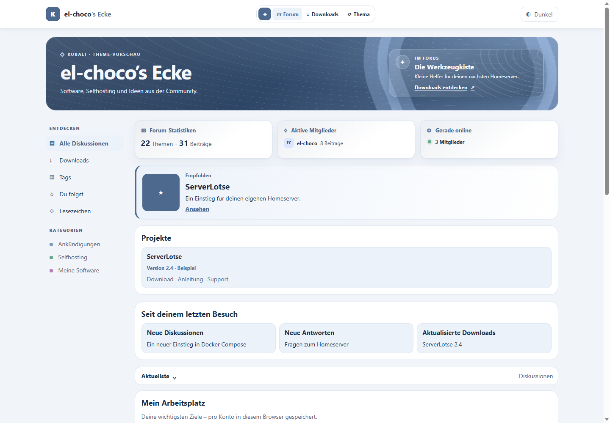

# Kobalt

**Kobalt** is a theme for Flarum 2 with rounded discussion cards and a layout built around the accent color **`#4d698e`**. It brings discussions, software projects, and community features together in one interface.

Use **Kobalt Studio** in the admin panel to configure navigation, the home page banner, featured content, project cards, and layout. Members can use personal shortcuts, a getting-started checklist, and a reading mode.

**Package** `el-choco/kobalt` · **Version** `0.1.0-alpha.15` · **License** MIT

> Kobalt is in alpha. Check that the requested version is listed on Packagist before running the Composer command. For a local package, follow [Install from a ZIP archive](#install-from-a-zip-archive).



[Interactive preview](preview/index.html) · [Mobile preview](preview/mobile.png) · [License](LICENSE)

The preview uses sample data. Your forum displays its own content and enabled extensions. Download the HTML preview to open it in your browser. GitHub displays it as source.

## Contents

- [Features](#features)
- [Requirements](#requirements)
- [Install with Composer](#install-with-composer)
- [Install from a ZIP archive](#install-from-a-zip-archive)
- [Kobalt Studio](#kobalt-studio)
- [Extensions and integrations](#extensions-and-integrations)
- [Updating](#updating)
- [Data storage and permissions](#data-storage-and-permissions)
- [Frequently asked questions](#frequently-asked-questions)
- [Development](#development)

## Features

### Forum layout

- Rounded discussion cards with author, date, and available post excerpts.
- Configurable accent color, feed width, corner radius, and card spacing.
- Light and dark styles that follow the active Flarum color scheme.
- A configurable home page banner with three background styles and an optional glass effect.
- A focus card for important content inside the banner.
- Up to three Orbit shortcuts in the center of the header.
- A widget strip above the feed that scrolls horizontally on narrow screens.
- A configurable footer with an information block, four link columns, and social links.
- A compact control for starting discussions.
- An optional action bar for replies, reactions, and sharing.
- Category-colored card accents and a red border for Super Sticky discussions.

### Featured content and projects

- A featured card for an existing discussion or custom content with text, an image, and a link.
- Up to three software project cards with version, download, documentation, support, and source code links.
- Optional display of the published version and file page from Depot.
- A toolbox inside a software or support discussion.
- Category notices with custom text and an optional link.
- Content modes for support, guides, and software discussions.

### Member features

- **My workspace** holds up to eight personal shortcuts and lets members pin discussions directly.
- **Getting started** offers a checklist of up to five steps for visitors.
- **Since your last visit** shows selected new discussions, replies, and updated Depot downloads.
- **Support filters** show All, Open, and Solved with FoF Best Answer.
- **My topics** shows discussions from categories followed with FoF Follow Tags.
- **Reading mode** hides side navigation and lets readers choose font size and line spacing.
- **Guide outlines** link to headings in the first post once it has loaded.

### Admin settings

Kobalt Studio has ten sections with a live preview. **German and English** interface translations are included. Install and enable the corresponding Flarum language pack for your forum language.

## Requirements

| Requirement | Supported range |
| --- | --- |
| Flarum | `^2.0.2`, starting at 2.0.2 within the 2.x series |
| PHP | `^8.3`, covering PHP 8.3 and later 8.x releases |
| Composer | Used for installation and updates |
| Browser | A current browser with support for modern CSS features |

Kobalt targets Flarum 2. Its base theme runs without Admin Console, a dedicated worker, a cron job, or other extensions.

Local checks used Flarum 2.0.2. Use a test installation to check new combinations of Flarum versions and extensions.

## Install with Composer

If you installed Kobalt from a local ZIP and want to use Packagist, first follow [Switch from a ZIP archive to Packagist](#switch-from-a-zip-archive-to-packagist).

### Standard Flarum 2 installation

Run the commands from the forum root as the user that manages the Flarum installation. This example uses `/var/www/flarum` and `www-data`.

```bash
cd /var/www/flarum
runuser -u www-data -- composer require el-choco/kobalt:"0.1.0-alpha.15" --update-no-dev --minimal-changes --no-scripts --no-interaction
```

After installation, go to **Extensions** in the admin panel, disable the previous theme, and enable **Kobalt**. Then rebuild the cache.

```bash
cd /var/www/flarum
runuser -u www-data -- php flarum cache:clear --force
```

If OPcache still serves old PHP files, reload the PHP-FPM service for your installation. Then reload the forum in your browser.

### CrazyMax with Docker Compose

This example uses the Compose service **`flarum`**, the container user **`flarum`**, and **`/opt/flarum`** as the Flarum directory. Run the commands on the Docker host in the directory containing the Compose file for your running installation.

For Portainer, use the configuration for the running stack. You can install the theme in the existing container.

```bash
cd /mnt/wdblue/flarum2

docker compose exec -T --user flarum \
  --env COMPOSER_HOME=/data/extensions/composer-home \
  --workdir /opt/flarum flarum \
  composer require el-choco/kobalt:"0.1.0-alpha.15" \
  --update-no-dev --minimal-changes --no-scripts --no-interaction && \
docker compose exec -T --user flarum flarum extension sync
```

After successful installation, `extension sync` saves the extension list for CrazyMax persistence. Keep the persistent `/data` volume.

Disable the previous theme, enable Kobalt in the admin panel, and run the following commands.

```bash
docker compose exec -T --user flarum --workdir /opt/flarum \
  flarum php flarum cache:clear --force && \
docker compose exec -T flarum s6-svc -r /run/service/php-fpm
```

The second command restarts PHP-FPM in the CrazyMax container so it loads the new package version. Web requests may be interrupted briefly. Reload the forum afterward.

If you only have the running container, use `docker exec --user flarum --workdir /opt/flarum flarum2-flarum-1 ...` in place of `docker compose exec -T --user flarum --workdir /opt/flarum flarum ...`. The Compose service is `flarum` in this example and the container is `flarum2-flarum-1`.

The `extension sync` and `s6-svc` commands are specific to the CrazyMax image. For other images, follow their instructions for the installation user, persistence, and PHP service management.

## Install from a ZIP archive

The file `kobalt-0.1.0-alpha.15.zip` includes the compiled JavaScript. You can install it on the forum server without Node.js.

### CrazyMax from a ZIP archive

Copy the ZIP file to `/tmp/kobalt-0.1.0-alpha.15.zip` on the Docker host. This example uses the existing `/mnt/wdblue/flarum2/data:/data` mount.

```bash
install -d -m 755 /mnt/wdblue/flarum2/data/theme-sources
unzip /tmp/kobalt-0.1.0-alpha.15.zip -d /mnt/wdblue/flarum2/data/theme-sources
cd /mnt/wdblue/flarum2

docker compose exec -T --user flarum flarum \
  test -r /data/theme-sources/kobalt-0.1.0-alpha.15/composer.json
```

Once the container can read the file, configure the local Composer repository and install the package.

```bash
docker compose exec -T --user flarum \
  --env COMPOSER_HOME=/data/extensions/composer-home \
  --workdir /opt/flarum flarum \
  composer config --global repositories.kobalt \
  '{"type":"path","url":"/data/theme-sources/kobalt-0.1.0-alpha.15","options":{"symlink":false,"versions":{"el-choco/kobalt":"0.1.0-alpha.15"}}}' && \
docker compose exec -T --user flarum \
  --env COMPOSER_HOME=/data/extensions/composer-home \
  --workdir /opt/flarum flarum \
  composer require el-choco/kobalt:"0.1.0-alpha.15" \
  --update-no-dev --minimal-changes --no-scripts --no-interaction && \
docker compose exec -T --user flarum flarum extension sync
```

Enable Kobalt, then rebuild the cache and restart PHP-FPM as described in [CrazyMax with Docker Compose](#crazymax-with-docker-compose). Keep the source directory under `/data/theme-sources` while Composer references it. This setup uses the existing container mount.

### Standard Flarum 2 installation from a ZIP archive

Extract the ZIP outside the public web directory. This example uses `/var/www/flarum` and `www-data`.

```bash
install -d -m 755 /var/www/flarum-theme-sources
unzip /tmp/kobalt-0.1.0-alpha.15.zip -d /var/www/flarum-theme-sources
cd /var/www/flarum

runuser -u www-data -- composer config repositories.kobalt \
  '{"type":"path","url":"/var/www/flarum-theme-sources/kobalt-0.1.0-alpha.15","options":{"symlink":false,"versions":{"el-choco/kobalt":"0.1.0-alpha.15"}}}' && \
runuser -u www-data -- composer require el-choco/kobalt:"0.1.0-alpha.15" \
  --update-no-dev --minimal-changes --no-scripts --no-interaction
```

Disable the previous theme, enable Kobalt, and rebuild the cache as `www-data` with `php flarum cache:clear --force`. Keep the source directory while you use the local Composer repository.

## Kobalt Studio

Go to **Administration → Extensions → Kobalt**.

The live preview uses sample content to show your unsaved changes. Select **Save Changes** to apply them to Flarum, then reload the forum. **Apply defaults** fills the form with default values. Save the form to apply them.

### 1. Orbit

Add up to three links to the center of the header. Set a label and destination for each link. Kobalt hides entries with empty destinations or unavailable named routes.

| Example destination | Opens |
| --- | --- |
| `@index` | Flarum's registered index route |
| `@depot.index` | The Depot index when the route is available |
| `@tags` | The tags index when the route is available |
| `downloads` | A path relative to the forum's base URL |
| `/downloads` | A path relative to the domain root |
| `https://example.org/handbuch` | An external HTTPS address |

If Flarum runs in a subdirectory, paths beginning with `/` still start at the domain root. External destinations must use HTTPS.

### 2. Stage

- Show or hide the home page banner.
- Set a custom heading and description. Leave either field empty to use the existing forum text.
- Choose an **Orbit**, **Grid**, or **Gradient** background.
- Enable the optional glass effect.
- Configure the focus card's section label, title, description, link label, and destination.

Use the focus card to link to a download, announcement, or guide. Kobalt can display the banner even after a visitor dismisses Flarum's welcome area.

### 3. Featured

Choose a source for the featured card.

- **Custom content** uses a title, a short description, an optional image, and a destination.
- **Existing discussion** accepts an ID, a slug, or a discussion link from your forum. Leave the title empty to use the discussion title.

The values `28`, `28-serverlotse`, and `/d/28-serverlotse` can all point to the same discussion. Kobalt displays a featured discussion when the visitor has permission to load its title through the API.

### 4. Projects

Configure up to three project cards. Each can display the project name, a manually entered version, and links to the download, documentation, support, and source code.

Enter a Depot slug to display the published version and link to the file page. The slug is the part after `/downloads/f/` in the file URL. Kobalt falls back to the manually entered version when Depot data is unavailable. Leave the project name blank to hide the card.

A project can also appear as a toolbox inside a discussion. Set the matching support discussion link or assign the project to a category with the **Software** mode. Enable the toolbox under **Comfort**.

### 5. Community

**Since your last visit** shows signed-in members a selection of new discussions, replies, and Depot releases. The first visit sets the baseline. A home page visit starts a new visit window after a gap of at least 30 minutes between home page visits. The overview shows a selection of activity.

**Support filters** add All, Open, and Solved to categories configured as Q&A with FoF Best Answer. A link takes readers directly to the best answer when it is available.

**My topics** gives signed-in members a view of discussions from categories they follow with FoF Follow Tags.

### 6. Comfort

| Feature | What it does |
| --- | --- |
| My workspace | Shows up to eight personal shortcuts on the home page. Members can pin or unpin a discussion from inside it. |
| Getting started | Shows the configured getting-started checklist on the home page. |
| Reading mode | Hides side navigation in discussions and offers font size and line spacing controls. |
| Toolbox | Displays matching project information inside a discussion. |
| Category notices | Displays notices configured under Categories. |
| Content modes | Applies the Support, Guide, or Software features configured under Categories. |

All six features are off by default. Enable each one independently.

The workspace is available to signed-in members. Reading mode offers **15, 17, or 19 px** font sizes and **1.6, 1.8, or 2** line spacing. Leaving the discussion ends reading mode. The browser remembers the selected values.

### 7. Getting started

Create up to five steps with a title and a destination for each. Only steps with both fields filled in appear. Enable the checklist under **Comfort**.

| Step | Title | Destination |
| --- | --- | --- |
| 1 | Welcome to the forum | Your welcome discussion |
| 2 | Read our rules | Your terms of use |
| 3 | Explore the tools | The downloads index |
| 4 | Introduce yourself | An introductions discussion |
| 5 | Start your first project | A relevant guide |

Visitors check off each step themselves. Opening a link leaves the step unchecked. If you change a step's title or destination, Kobalt treats it as a new step. Guests can use the checklist in their browser too.

### 8. Categories

Configure up to three rules by category slug. For `/t/docker`, enter `docker`. If a discussion matches multiple rules, the first configured match applies.

Each rule can include a notice, an optional link, and a content mode.

| Mode | What it adds to the discussion |
| --- | --- |
| Standard | The standard discussion layout |
| Support | Open or Solved status and a best-answer link when available. Requires FoF Best Answer. |
| Guide | A table of contents from the `h2` and `h3` headings in the loaded first post. |
| Software | The assigned project's toolbox when enabled. |

Notices appear in the category view and in its discussions. Enable category notices or content modes under **Comfort**.

A guide outline includes up to 30 headings. When a visitor opens a later reply directly and the first post has yet to load, the outline offers a link to the first post.

### 9. Footer

Kobalt includes a built-in footer that is off by default. If Modern Footer is active, turn off its output or disable the extension before enabling the Kobalt footer.

Under **Footer → General**, you can:

- Display the footer on all pages, on the home page only, or everywhere except discussions.
- Choose **Soft** or **Kobalt blue**. Soft follows the light or dark color scheme.
- Show or hide the footer on mobile devices.
- Set 0, 56, 72, or 96 px of extra space below the footer for a fixed mobile navigation bar. Kobalt accounts for the device's safe area separately.
- Configure an information block with an optional existing forum logo, a title, and a description. An empty title uses the forum name.
- Set the copyright text. `© {year} {forum}` inserts the current year and forum name. Leave the field empty to hide the copyright text.
- Show a back-to-top button.

Under **Link columns**, configure and enable up to four columns individually. Each has a title, an optional Font Awesome icon, and up to six links. Suggested columns include Community, Software, Help, and Legal. Kobalt displays links with a label and a valid destination and hides empty columns.

Under **Social links**, add up to four entries with labels, destinations, and optional icons. They appear in the information block. Use icons available in the loaded font, such as `fab fa-github`, `fab fa-discord`, or `fas fa-book`. Labels remain visible without icons.

Internal links use forum navigation. External HTTPS links open in a new tab. The same destination rules apply as in Orbit. Footer fields accept plain text only.

The live preview shows your draft regardless of which pages you select for display. The forum applies those page filters after you save and reload.

### 10. Layout

- Accent color, `#4d698e` by default.
- Feed width options Standard, Wide, and Narrow.
- Corner radius options Soft, Round, and Subtle.
- Card spacing options Airy and Compact.
- Compact discussion composer and widget strip.
- Shoutbox message area height.
- Discussion action bar and category-colored card accents.

**Super Sticky discussions have a 4 px red left border in `#e74c3c`.** It takes precedence over the category accent. Stickiest handles pinning and sorting.

The post column in a discussion has a maximum width of `150ch`, subject to available screen space. The theme sets this value directly, outside the Studio settings.

In the action bar, **Reply** opens the discussion and **Share** uses the browser's sharing feature or copies the link. Kobalt uses FoF Reactions' picker when the visitor can access and react to the first post. Otherwise, Kobalt may link to the first post. Available reactions appear with their total count.

## Extensions and integrations

These extensions are optional. Use versions compatible with Flarum 2.

| Extension | How Kobalt uses it |
| --- | --- |
| FoF Forum Widgets Core | Shows existing right-side widgets in a strip above the feed. |
| Depot | Adds published project versions, file pages, and recent downloads. |
| FoF Best Answer | Provides support filters, best-answer links, and support status. |
| FoF Follow Tags | Adds the My topics view for followed categories. |
| FoF Reactions | Adds the existing reaction picker and counts to the feed. |
| Modern Footer | An alternative to Kobalt's built-in footer. Enable one footer at a time. |
| Stickiest | Kobalt styles Super Sticky discussions with a red border. Stickiest controls sorting. |
| FoF Synopsis | Supplies available post excerpts for the discussion list. |

To reproduce the preview's widget layout, assign **Forum statistics**, **Active members**, and **Online now** to the **right** position in FoF Forum Widgets Core. Kobalt moves them above the feed. The **Top** position is also available. The widget strip uses widgets assigned in the extension.

Move the Shoutbox to **Bottom** in its widget settings if you want discussions to appear higher on the page. Kobalt's height setting applies to the message area in widget positions styled by the theme.

Kobalt builds on Flarum's components and extension points. Check compatibility with your extensions. Styles can conflict when multiple full themes are active.

## Updating

### Update a Composer installation

Let any ongoing package operations finish. Repeat the relevant Composer installation steps using the version you want. On CrazyMax, run `extension sync` after the package update succeeds, then rebuild the cache and restart PHP-FPM.

A normal package update preserves Studio settings. New features may be off by default.

### Update a local ZIP installation

Extract the new ZIP into a separate version directory and point the local Composer repository at that directory and version. Then run Composer. The [ZIP instructions](#install-from-a-zip-archive) use Alpha 15 as the example.

Remove an older source directory only after Composer, installed symlinks, and other services have stopped referencing it.

### Switch from a ZIP archive to Packagist

A local Composer repository can take precedence over a published release. Remove the Kobalt repository entry you previously configured before switching.

For a standard installation with the repository configured in the project:

```bash
cd /var/www/flarum
runuser -u www-data -- composer config --unset repositories.kobalt
```

For CrazyMax with the repository configured globally:

```bash
cd /mnt/wdblue/flarum2

docker compose exec -T --user flarum \
  --env COMPOSER_HOME=/data/extensions/composer-home \
  --workdir /opt/flarum flarum \
  composer config --global --unset repositories.kobalt
```

Install the desired published version with Composer and run the completion steps for your setup. If you originally used a different repository name or location, check that configuration first. Remove only the entry for Kobalt.

## Data storage and permissions

| Data | Storage and behavior |
| --- | --- |
| Studio settings | Flarum settings in the database |
| Workspace | Local browser storage, separate for each forum and signed-in account |
| Completed getting-started steps | Local browser storage, separate for each forum and account or guest profile |
| Visit baseline | Local browser storage for the signed-in account |
| Font size and line spacing | Local browser storage, separate for each forum and account or guest profile |

Browser settings are specific to the device and browser profile. Clearing site data removes them. Guest checklist progress remains separate when a visitor signs in.

Banner text, notices, getting-started steps, and project details entered in Studio are public. Keep confidential information out of these fields. Additional API requests use the visitor's existing permissions, including when a card points to protected content.

Kobalt has no database migrations. To switch themes temporarily, disable Kobalt, enable the other theme, and rebuild the cache.

## Frequently asked questions

### Can I keep my existing widgets and extensions enabled?

Kobalt's core features work alongside existing widgets. Configure the widgets and assign their positions in the relevant extension. Disable the previous full theme when switching to Kobalt.

### Why do changes appear only in the Studio preview?

The preview displays draft values. Select **Save Changes**, then reload the forum. After a package update, rebuild the cache and reload PHP-FPM if OPcache still serves older files.

### Why are the workspace, getting-started checklist, or toolbox missing?

Enable the relevant feature under **Comfort**. The workspace requires signing in. Each getting-started step needs a title and valid destination. The toolbox needs a named project and either a matching support discussion link or a Software category rule.

### Why are excerpts or reactions missing from a card?

Kobalt uses post data already available in the feed. Excerpts and reactions depend on the available excerpt or first post and the visitor's permissions.

### Does Kobalt make additional requests?

Enabled features can call your forum's API to load a featured discussion, Depot project data, or visit updates. External images load from their configured URLs. Manually entered content can be displayed without the corresponding data requests.

### How can I investigate slow page loads?

Open **F12 → Network**, reload the home page, and compare timing for the main document, JavaScript, and API requests. If a browser content script repeatedly reports errors, compare the results in a private window with browser extensions disabled.

To measure the Shoutbox's impact, temporarily remove its widget from the layout and repeat the measurement under the same conditions. Compare the measurements before attributing the slowdown to an extension.

## Development

The installation files include compiled JavaScript bundles. To build frontend changes:

```bash
cd js
npm install
npm run build
```

| Directory or file | Contents |
| --- | --- |
| `js/src/` | Forum features and Kobalt Studio |
| `js/dist/` | Compiled JavaScript bundles and source maps |
| `less/` | Forum, Studio, and admin styles |
| `locale/` | German and English interface strings |
| `settings.json` | Studio defaults |
| `src/ForumSettings.php` | Makes theme settings available to the forum frontend |
| `preview/` | Static preview with sample data |

Local checks cover the frontend build, translations, styles, saving and loading Studio settings, and selected functional and browser checks. Test with your own extensions and content on the target system.

## Design credit

The settings in [Modern Footer](https://github.com/huseyinfiliz/modern-footer) inspired Kobalt's footer. Kobalt uses its own implementation and styling.

## License

Kobalt is available under the [MIT License](LICENSE).

**Developed by el-choco.**


---

# Kobalt

### Dein Forum. Deine Community. Dein Stil.

**Kobalt** ist ein Theme für Flarum 2 mit einer modernen Kartenansicht, weichen Rundungen und einer klaren Gestaltung rund um die Akzentfarbe **`#4d698e`**. Es verbindet Diskussionen, Softwareprojekte und Community-Funktionen zu einer gemeinsamen Oberfläche.

Im **Kobalt Studio** gestaltest du Navigation, Banner, Empfehlungen, Projektkarten und Layout direkt im Adminbereich. Persönliche Schnellzugriffe, ein Einstiegspfad und ein Lesemodus ergänzen das Forum für seine Besucher.

**Paket:** `el-choco/kobalt` · **Stand:** `0.1.0-alpha.15` · **Lizenz:** MIT

> Kobalt befindet sich in der Alpha-Phase. Prüfe vor der Installation mit Composer, ob die gewünschte Version auf Packagist gelistet ist. Für eine lokale Paketquelle verwende die [Installation aus dem ZIP](#installation-aus-dem-zip).


[Interaktive Vorschau](preview/index.html) · [Mobile Vorschau](preview/mobile.png) · [Lizenz](LICENSE)

Die Vorschau verwendet Beispieldaten. Im installierten Forum erscheinen deine Inhalte und die aktivierten Erweiterungen. Die HTML-Vorschau lässt sich nach dem Herunterladen lokal im Browser öffnen; GitHub zeigt sie als Quelldatei an.

## Inhalt

- [Funktionen](#funktionen)
- [Voraussetzungen](#voraussetzungen)
- [Installation mit Composer](#installation-mit-composer)
- [Installation aus dem ZIP](#installation-aus-dem-zip)
- [Kobalt Studio](#kobalt-studio)
- [Erweiterungen und Integrationen](#erweiterungen-und-integrationen)
- [Aktualisieren](#aktualisieren)
- [Datenspeicherung und Berechtigungen](#datenspeicherung-und-berechtigungen)
- [Häufige Fragen](#häufige-fragen)
- [Entwicklung](#entwicklung)

## Funktionen

### Eine neue Bühne für deine Community

- Abgerundete Diskussionskarten mit Autorenzeile, Datum und vorhandenen Beitragsauszügen.
- Konfigurierbare Akzentfarbe, Feedbreite, Rundung und Kartenabstände.
- Helle und dunkle Darstellung passend zum aktiven Flarum-Farbschema.
- Anpassbarer Startseitenbanner mit drei Hintergrundstilen und optionalem Glas-Look.
- Fokus-Karte für wichtige Inhalte direkt im Banner.
- Bis zu drei zentrale Orbit-Schnellzugriffe in der Kopfzeile.
- Widget-Leiste oberhalb des Feeds; auf kleinen Bildschirmen horizontal scrollbar.
- Konfigurierbarer Footer mit Infobereich, vier Linkspalten und Social-Links.
- Kompakter Bereich zum Starten einer Diskussion.
- Optionale Aktionsleiste für Antworten, Reaktionen und Teilen.
- Kategorienfarben als Kartenakzent und ein eigener roter Rand für Super-Sticky-Themen.

### Inhalte gezielt hervorheben

- Empfehlungskarte für eine vorhandene Diskussion oder eigene Inhalte mit Text, Bild und Link.
- Bis zu drei Software-Projektkarten mit Version, Download, Anleitung, Support und Quellcode.
- Optionale Übernahme der veröffentlichten Version und Dateiseite aus Depot.
- Werkzeugkasten im geöffneten Software- oder Support-Thema.
- Kategoriehinweise mit frei wählbarem Text und optionalem Link.
- Unterschiedliche Ergänzungen für Support-, Anleitungs- und Software-Themen.

### Mehr Orientierung für Mitglieder

- **Mein Arbeitsplatz:** bis zu acht persönliche Schnellzugriffe, einschließlich direkt angehefteter Diskussionen.
- **Einstieg:** bis zu fünf selbst abhakbare Schritte für neue Besucher.
- **Seit deinem letzten Besuch:** eine Auswahl neuer Themen, neuer Antworten und aktualisierter Depot-Downloads.
- **Support-Filter:** Alle, Offen und Gelöst mit FoF Best Answer.
- **Meine Themen:** Diskussionen aus verfolgten Kategorien mit FoF Follow Tags.
- **Lesemodus:** weniger seitliche Ablenkung sowie wählbare Schriftgröße und Zeilenabstände.
- **Anleitungsübersicht:** Sprungziele zu Überschriften im ersten geladenen Beitrag.

### Direkt im Adminbereich einrichten

Das Kobalt Studio enthält zehn Bereiche mit Live-Vorschau. Die Oberflächenübersetzungen für **Deutsch und Englisch** sind enthalten. Für die jeweilige Forumssprache muss das passende Flarum-Sprachpaket installiert und aktiviert sein.

## Voraussetzungen

| Voraussetzung | Unterstützter Bereich |
| --- | --- |
| Flarum | `^2.0.2` – ab 2.0.2 innerhalb der 2.x-Reihe |
| PHP | `^8.3` – PHP 8.3 und spätere 8.x-Versionen |
| Composer | Für Installation und Updates |
| Browser | Aktueller Browser mit Unterstützung für moderne CSS-Funktionen |

**Flarum 1.8 wird von Kobalt nicht unterstützt.** Kobalt benötigt weder die Admin Console noch einen eigenen Worker oder Cronjob. Zusätzliche Erweiterungen sind für die Grundgestaltung nicht erforderlich.

Die Versionsanforderungen geben den zulässigen Bereich an, keine vollständige Testmatrix aller zukünftigen Versionen. Lokale Prüfungen wurden mit Flarum 2.0.2 durchgeführt; neue Kombinationen sollten zunächst in einer Testinstallation geprüft werden.

## Installation mit Composer

> Falls du bisher eine lokale Kobalt-Paketquelle verwendest, beachte vor dem Wechsel zu Packagist den Abschnitt [Aktualisieren](#aktualisieren).

### Normale Flarum-2-Installation

Die Befehle im Hauptverzeichnis deines Forums als dessen Installationsbenutzer ausführen. Das Beispiel verwendet `/var/www/flarum` und `www-data`.

```bash
cd /var/www/flarum
runuser -u www-data -- composer require el-choco/kobalt:"0.1.0-alpha.15" --update-no-dev --minimal-changes --no-scripts --no-interaction
```

Nach erfolgreicher Installation:

1. Im Adminbereich unter **Erweiterungen** das bisherige Theme deaktivieren.
2. **Kobalt** aktivieren.
3. Den Cache neu aufbauen:

```bash
cd /var/www/flarum
runuser -u www-data -- php flarum cache:clear --force
```

Falls PHP alte Dateien im OPcache behält, den zu deiner Installation gehörenden PHP-FPM-Dienst neu laden. Anschließend das Forum im Browser neu laden.

### CrazyMax mit Docker Compose

Dieses Beispiel verwendet den Compose-Dienst **`flarum`**, den Container-Benutzer **`flarum`** und das Flarum-Verzeichnis **`/opt/flarum`**. Die Befehle auf dem Docker-Host im Verzeichnis der tatsächlich verwendeten Compose-Datei ausführen.

Bei Portainer die zum laufenden Stack gehörende Konfiguration verwenden. Für die Theme-Installation ist kein erneutes Bereitstellen des Stacks nötig.

```bash
cd /mnt/wdblue/flarum2

docker compose exec -T --user flarum \
  --env COMPOSER_HOME=/data/extensions/composer-home \
  --workdir /opt/flarum flarum \
  composer require el-choco/kobalt:"0.1.0-alpha.15" \
  --update-no-dev --minimal-changes --no-scripts --no-interaction && \
docker compose exec -T --user flarum flarum extension sync
```

`extension sync` übernimmt nach der erfolgreichen Paketinstallation die Erweiterungsliste für die CrazyMax-Persistenz. Das persistente `/data`-Volume beibehalten.

Danach das bisherige Theme deaktivieren, Kobalt im Adminbereich aktivieren und ausführen:

```bash
docker compose exec -T --user flarum --workdir /opt/flarum \
  flarum php flarum cache:clear --force && \
docker compose exec -T flarum s6-svc -r /run/service/php-fpm
```

Der zweite Befehl startet PHP-FPM im CrazyMax-Container neu, damit die neue Paketversion geladen wird. Dabei können Webanfragen kurz unterbrochen sein. Anschließend das Forum neu laden.

**Keine lokale Compose-Datei verfügbar?** Beim bekannten Container `flarum2-flarum-1` entspricht beispielsweise `docker compose exec -T --user flarum --workdir /opt/flarum flarum ...` dem Aufruf `docker exec --user flarum --workdir /opt/flarum flarum2-flarum-1 ...`. Dienst- und Containername sind unterschiedliche Angaben.

Die CrazyMax-Befehle `extension sync` und `s6-svc` gelten für dieses Image. Bei anderen Docker-Images sind deren Installationsbenutzer, Persistenz und PHP-Dienstverwaltung maßgeblich.

## Installation aus dem ZIP

Die Datei `kobalt-0.1.0-alpha.15.zip` enthält den fertigen Browser-Build. Node.js wird auf dem Forumserver nicht benötigt.

### CrazyMax / Docker Compose

Die ZIP zunächst nach `/tmp/kobalt-0.1.0-alpha.15.zip` auf den Docker-Host übertragen. Das Beispiel setzt den bestehenden Mount `/mnt/wdblue/flarum2/data:/data` voraus.

```bash
install -d -m 755 /mnt/wdblue/flarum2/data/theme-sources
unzip /tmp/kobalt-0.1.0-alpha.15.zip -d /mnt/wdblue/flarum2/data/theme-sources
cd /mnt/wdblue/flarum2

docker compose exec -T --user flarum flarum \
  test -r /data/theme-sources/kobalt-0.1.0-alpha.15/composer.json
```

Nur wenn die Datei im Container lesbar ist, die lokale Composer-Quelle eintragen und installieren:

```bash
docker compose exec -T --user flarum \
  --env COMPOSER_HOME=/data/extensions/composer-home \
  --workdir /opt/flarum flarum \
  composer config --global repositories.kobalt \
  '{"type":"path","url":"/data/theme-sources/kobalt-0.1.0-alpha.15","options":{"symlink":false,"versions":{"el-choco/kobalt":"0.1.0-alpha.15"}}}' && \
docker compose exec -T --user flarum \
  --env COMPOSER_HOME=/data/extensions/composer-home \
  --workdir /opt/flarum flarum \
  composer require el-choco/kobalt:"0.1.0-alpha.15" \
  --update-no-dev --minimal-changes --no-scripts --no-interaction && \
docker compose exec -T --user flarum flarum extension sync
```

Danach Kobalt aktivieren sowie Cache und PHP-FPM wie im [Docker-Abschnitt](#crazymax-mit-docker-compose) neu laden. Den Quellordner unter `/data/theme-sources` behalten, solange Composer darauf verweist. Ein zusätzlicher Container-Mount ist bei diesem Beispiel nicht nötig.

### Normale Flarum-2-Installation

Die ZIP außerhalb des öffentlichen Web-Verzeichnisses entpacken. Beispiel für `/var/www/flarum` mit `www-data`:

```bash
install -d -m 755 /var/www/flarum-theme-sources
unzip /tmp/kobalt-0.1.0-alpha.15.zip -d /var/www/flarum-theme-sources
cd /var/www/flarum

runuser -u www-data -- composer config repositories.kobalt \
  '{"type":"path","url":"/var/www/flarum-theme-sources/kobalt-0.1.0-alpha.15","options":{"symlink":false,"versions":{"el-choco/kobalt":"0.1.0-alpha.15"}}}' && \
runuser -u www-data -- composer require el-choco/kobalt:"0.1.0-alpha.15" \
  --update-no-dev --minimal-changes --no-scripts --no-interaction
```

Anschließend das bisherige Theme deaktivieren, Kobalt aktivieren und den Cache als `www-data` mit `php flarum cache:clear --force` neu aufbauen. Den Quellordner behalten, solange die lokale Paketquelle verwendet wird.

## Kobalt Studio

Öffne **Administration → Erweiterungen → Kobalt**.

Die Live-Vorschau zeigt deine noch nicht gespeicherten Entwurfswerte mit Beispieldaten. Erst **Änderungen speichern** übernimmt sie in die Flarum-Einstellungen. Danach die Forumsseite neu laden. **Standardwerte einsetzen** füllt das Formular mit den Vorgaben; auch diese müssen gespeichert werden.

### 1. Orbit – deine Schnellzugriffe

Bis zu drei Links in der mittleren Kopfzeilennavigation. Pro Link legst du Beschriftung und Ziel fest. Leere Ziele und nicht vorhandene benannte Routen werden im Forum ausgeblendet.

| Beispielziel | Bedeutung |
| --- | --- |
| `@index` | Flarums registrierte Index-Route |
| `@depot.index` | Depot-Übersicht, wenn die Route verfügbar ist |
| `@tags` | Kategorienübersicht, wenn die Route verfügbar ist |
| `downloads` | Adresse relativ zur Basisadresse deines Forums |
| `/downloads` | Adresse relativ zur Domainwurzel |
| `https://example.org/handbuch` | Externer HTTPS-Link |

Bei einer Installation in einem Unterverzeichnis auf den Unterschied zwischen relativen Adressen und Adressen mit führendem `/` achten. Externe Ziele müssen HTTPS verwenden.

### 2. Bühne – Banner und Fokus-Karte

- Startseitenbanner ein- oder ausblenden.
- Eigene Überschrift und Beschreibung festlegen. Leere Felder verwenden die vorhandenen Forumstexte.
- Hintergrundstil wählen: **Umlaufbahnen**, **Raster** oder **Farbverlauf**.
- Optionalen Glas-Look aktivieren.
- Fokus-Karte mit Rubrik, Titel, Beschreibung, Linktext und Ziel gestalten.

Die Fokus-Karte eignet sich für einen wichtigen Download, eine Ankündigung oder dein Handbuch. Kobalt kann den Startseitenbanner auch anzeigen, wenn der normale Flarum-Willkommensbereich bereits geschlossen wurde.

### 3. Empfehlung – einen Inhalt in den Mittelpunkt stellen

Wähle zwischen zwei Quellen:

- **Eigene Inhalte:** Titel, Kurztext, optionales Bild und Zieladresse.
- **Vorhandene Diskussion:** ID, Slug oder Themenlink aus deinem Forum. Ein leerer Titel verwendet den Diskussionstitel.

Beispielsweise verweisen `28`, `28-serverlotse` und `/d/28-serverlotse` auf dasselbe Thema. Im Diskussionsmodus wird die Karte nur angezeigt, wenn dessen Titel über die API mit den Rechten des Besuchers geladen werden kann.

### 4. Projekte – deine Software auf einen Blick

Bis zu drei Projektkarten mit:

- Projektname und manuell gepflegter Version.
- Download-, Anleitungs-, Support- und Quellcode-Link.
- Optionalem Depot-Slug für die veröffentlichte Version und den Link zur Dateiseite.

Ein leerer Projektname blendet die Karte aus. Der Depot-Slug ist der Teil nach `/downloads/f/` in der Dateiadresse. Ohne verfügbare Depot-Daten bleibt die manuell eingetragene Version erhalten.

Projektkarten lassen sich zusätzlich als Werkzeugkasten in einem Thema anzeigen. Dazu entweder den passenden Support-Themenlink eintragen oder das Projekt einer Kategorie mit der Darstellungsart **Software** zuordnen und den Werkzeugkasten unter **Erlebnis** einschalten.

### 5. Community – Aktivitäten und gezielte Ansichten

**Seit deinem letzten Besuch** zeigt angemeldeten Mitgliedern eine begrenzte Auswahl neuer Diskussionen, neuer Antworten und aktueller Depot-Veröffentlichungen. Der erste Besuch legt einen Ausgangspunkt an. Nach mindestens 30 Minuten Abstand zwischen Startseitenaufrufen beginnt ein neues Besuchsfenster. Die Übersicht ist eine Orientierung und kein vollständiges Aktivitätsprotokoll.

**Support-Filter** ergänzt Alle, Offen und Gelöst in Kategorien, die über FoF Best Answer als Frage und Antwort eingerichtet sind. Bei verfügbarer bester Antwort gibt es einen direkten Lösungslink.

**Meine Themen** ergänzt für angemeldete Mitglieder eine Ansicht der Diskussionen in den Kategorien, denen sie mit FoF Follow Tags folgen.

### 6. Erlebnis – persönliche Funktionen einschalten

| Funktion | Wirkung |
| --- | --- |
| Mein Arbeitsplatz | Bis zu acht persönliche Schnellzugriffe auf der Startseite; Diskussionen direkt im Thema anheften oder wieder lösen |
| Einstieg | Die unter Einstieg konfigurierten Schritte auf der Startseite anzeigen |
| Lesemodus | Im Thema seitliche Navigation ausblenden und Schriftgröße sowie Zeilenabstand wählen |
| Werkzeugkasten | Passende Projektinformationen im geöffneten Thema anzeigen |
| Kategoriehinweise | Die unter Kategorien hinterlegten Hinweise anzeigen |
| Inhaltsabhängige Darstellung | Die unter Kategorien gewählten Ergänzungen für Support, Anleitung oder Software aktivieren |

Diese sechs Funktionen sind standardmäßig ausgeschaltet und können unabhängig voneinander aktiviert werden.

Der Arbeitsplatz steht angemeldeten Mitgliedern zur Verfügung. Im Lesemodus gibt es **15, 17 oder 19 Pixel** Schriftgröße und **1,6, 1,8 oder 2** als Zeilenabstand. Der Modus endet beim Verlassen des Themas; die gewählten Größen bleiben im Browser gespeichert.

### 7. Einstieg – deine Besucher an die Hand nehmen

Erstelle bis zu fünf Schritte, jeweils mit **Titel** und **Zieladresse**. Nur vollständig ausgefüllte Einträge erscheinen. Aktiviere anschließend den Einstieg unter **Erlebnis**.

Ein Beispiel für eine Software-Community:

| Schritt | Titel | Ziel |
| --- | --- | --- |
| 1 | Willkommen im Forum | Deine Willkommensdiskussion |
| 2 | Unsere Regeln lesen | Deine Nutzungsbedingungen |
| 3 | Werkzeuge entdecken | Die Downloadübersicht |
| 4 | Stelle dich vor | Eine Vorstellungsdiskussion |
| 5 | Dein erstes Projekt | Eine passende Anleitung |

Besucher haken erledigte Schritte selbst ab. Das Öffnen eines Links setzt keinen Haken. Werden Text oder Ziel eines Schritts geändert, gilt dieser als neuer Schritt und muss erneut abgehakt werden. Auch Gäste können die Checkliste im jeweiligen Browser verwenden.

### 8. Kategorien – passende Informationen am passenden Ort

Bis zu drei Regeln lassen sich einem Kategorie-Slug zuordnen. Bei `/t/docker` ist der Slug `docker`. Trage den Slug ein, nicht die vollständige URL. Wenn ein Thema mehrere passende Kategorien hat, gilt die erste konfigurierte Regel.

Jede Regel enthält einen optionalen Hinweistext mit Link sowie eine Darstellungsart:

| Darstellung | Ergänzung im Thema |
| --- | --- |
| Standard | Keine zusätzliche inhaltsbezogene Darstellung |
| Support | Offen/Gelöst und gegebenenfalls ein Link zur besten Antwort; benötigt FoF Best Answer |
| Anleitung | Inhaltsverzeichnis aus den `h2`- und `h3`-Überschriften des geladenen ersten Beitrags |
| Software | Werkzeugkasten mit dem zugeordneten Projekt, sofern aktiviert |

Hinweise erscheinen sowohl in der Kategorieansicht als auch in zugehörigen Themen. Aktiviere **Kategoriehinweise** beziehungsweise **inhaltsabhängige Darstellung** unter **Erlebnis**.

Das Anleitungs-Inhaltsverzeichnis zeigt bis zu 30 Überschriften. Ist beim direkten Aufruf einer späteren Antwort der erste Beitrag noch nicht geladen, bietet es stattdessen einen Link zum ersten Beitrag.

### 9. Footer – ein passender Abschluss für dein Forum

Der Kobalt-Footer ist eigenständig und benötigt Modern Footer nicht. Er ist anfangs ausgeschaltet. Falls du Modern Footer verwendest, deaktiviere dessen Ausgabe beziehungsweise die Erweiterung, bevor du den Kobalt-Footer einschaltest. Kobalt verändert die Einstellungen der anderen Erweiterung nicht.

Unter **Footer → Allgemein** stehen folgende Optionen zur Verfügung:

- Footer einschalten und auf allen Seiten, nur der Startseite oder außerhalb von Diskussionen anzeigen.
- Darstellung **Weich** oder **Kobaltblau** wählen. Die weiche Darstellung folgt dem hellen oder dunklen Farbschema.
- Ausgabe auf Mobilgeräten ein- oder ausschalten.
- Zusätzlichen Abstand von 0, 56, 72 oder 96 Pixeln unter dem Footer vorsehen, beispielsweise für eine feste mobile Navigation. Der Wert wird manuell eingestellt; die Geräte-Sicherheitszone wird zusätzlich berücksichtigt.
- Infobereich mit optionalem vorhandenem Forumlogo, Titel und Beschreibung einrichten. Ein leerer Titel verwendet den Forumnamen.
- Copyright festlegen. `© {year} {forum}` setzt das aktuelle Jahr und den Forumnamen ein. Ein leeres Feld blendet den Copyright-Text aus.
- Einen Nach-oben-Button anzeigen.

Unter **Linkspalten** kannst du vier Spalten einzeln einrichten und ein- oder ausschalten. Jede enthält einen Titel, ein optionales Font-Awesome-Symbol und bis zu sechs Links. Beispielsweise könntest du Community, Software, Hilfe und Rechtliches verwenden. Nur Einträge mit gültigem Ziel und Linktext werden angezeigt; leere Spalten bleiben ausgeblendet.

Unter **Social-Links** stehen vier Einträge mit Beschriftung, optionalem Symbol und Ziel zur Verfügung. Sie erscheinen im Infobereich. Für Symbole funktionieren beispielsweise `fab fa-github`, `fab fa-discord` oder `fas fa-book`. Die jeweilige Schrift muss das Symbol enthalten. Beschriftungen bleiben auch ohne Symbol lesbar.

Interne Links verwenden die Forumsnavigation; externe HTTPS-Links öffnen einen neuen Tab. Für Ziele gelten dieselben Regeln wie bei Orbit. Die Inhalte sind Textfelder; eigene HTML- oder JavaScript-Blöcke gehören nicht zum Footer.

Die Live-Vorschau zeigt den Entwurf auch dann, wenn du als Ausgabe nur die Startseite ausgewählt hast. Die echte Seitenfilterung findet im Forum statt. Nach Änderungen speichern und das Forum neu laden.

### 10. Layout – das Erscheinungsbild abstimmen

- Akzentfarbe, standardmäßig `#4d698e`.
- Feedbreite: Standard, Breit oder Schmal.
- Rundung: Weich, Rund oder Dezent.
- Kartenabstände: Luftig oder Kompakt.
- Kompakter Diskussionsstart und Widget-Leiste.
- Höhe des Shoutbox-Nachrichtenbereichs.
- Aktionsleiste und Kategorienfarben als Kartenakzent.

**Super-Sticky-Themen erhalten immer einen roten linken Rand mit 4 Pixeln und `#e74c3c`.** Dieser hat Vorrang vor dem Kategorienakzent. Das Anheften und die Sortierung übernimmt weiterhin Stickiest.

Die maximale Breite der Beitragsspalte in geöffneten Diskussionen beträgt `150ch`; das tatsächliche Layout bleibt durch den verfügbaren Bildschirmplatz begrenzt. Dieser Wert ist derzeit im Theme festgelegt und kein Studio-Eingabefeld.

Die Aktionsleiste verwendet vorhandene Funktionen: Antworten öffnet das Thema; Teilen verwendet die Browserfreigabe oder kopiert den Link. Wenn FoF Reactions und ein sichtbarer erster Beitrag mit entsprechender Berechtigung verfügbar sind, verwendet Kobalt dessen Reaktionsauswahl. Andernfalls kann ein Link zum ersten Beitrag erscheinen. Verfügbare Reaktionen werden mit ihrer Gesamtzahl angezeigt.

## Erweiterungen und Integrationen

Alle folgenden Erweiterungen sind optional. Installiere für Flarum 2 geeignete Versionen.

| Erweiterung | Verwendung in Kobalt |
| --- | --- |
| FoF Forum Widgets Core | Vorhandene rechte Widgets als Leiste über dem Feed darstellen |
| Depot | Veröffentlichte Projektversionen, Dateiseiten und aktuelle Downloads ergänzen |
| FoF Best Answer | Support-Filter, Lösungslinks und Support-Status |
| FoF Follow Tags | Ansicht Meine Themen für verfolgte Kategorien |
| FoF Reactions | Vorhandene Reaktionsauswahl und Reaktionszahlen im Feed |
| Modern Footer | Alternative zum integrierten Kobalt-Footer; nur einen der beiden Footer aktivieren |
| Stickiest | Eigener roter Rand für Super-Sticky-Themen; Sortierung bleibt bei Stickiest |
| FoF Synopsis | Vorhandene Beitragsauszüge in der Diskussionsliste nutzen |

Für die typische Widget-Anordnung Forum-Statistiken, Aktivste Benutzer und Benutzer online im **rechten Bereich** von FoF Widgets Core platzieren. Kobalt ordnet sie oberhalb des Feeds an. Die Widget-Position **Oben** bleibt zusätzlich nutzbar. Ohne zugewiesene Widgets wird kein Beispielinhalt erzeugt.

Die Shoutbox kann über ihre eigene Widget-Konfiguration beispielsweise nach **Unten** verschoben werden, damit die Diskussionen früher sichtbar sind. Die Kobalt-Höheneinstellung begrenzt nur den Nachrichtenbereich an den von Kobalt gestalteten Widget-Positionen.

Kobalt ergänzt Flarums vorhandene Komponenten und Erweiterungspunkte. Es enthält keine Garantie für jede Kombination mit Drittanbieter-Erweiterungen. Insbesondere mehrere gleichzeitig aktive Themes können sich gegenseitig überschreiben.

## Aktualisieren

### Aus einer veröffentlichten Composer-Version

Vor dem Update laufende Paketoperationen abschließen. Anschließend die passende Composer-Installationssequenz mit der gewünschten veröffentlichten Versionsnummer erneut ausführen. Im CrazyMax-Container nach erfolgreicher Paketinstallation **`extension sync`**, Cache-Neuaufbau und PHP-FPM-Neustart durchführen.

Die Studio-Einstellungen bleiben beim normalen Paketupdate erhalten. Neue Funktionen sind gegebenenfalls zunächst ausgeschaltet.

### Von einer älteren lokalen ZIP-Version

Die neue ZIP in einen eigenen Versionsordner entpacken und die lokale Paketquelle auf diesen Ordner und die neue Versionsnummer umstellen. Danach Composer ausführen. Die ZIP-Anleitung zeigt das Vorgehen für Alpha 15.

Den alten Quellordner erst entfernen, wenn weder die Composer-Konfiguration noch ein installierter Symlink oder anderer Dienst darauf verweist.

### Später von der ZIP auf Packagist wechseln

Eine lokale Composer-Paketquelle kann eine veröffentlichte Version überdecken. Vor dem Wechsel gezielt den zuvor für Kobalt angelegten Eintrag entfernen.

Normale Installation, sofern der Eintrag wie oben im Projekt angelegt wurde:

```bash
cd /var/www/flarum
runuser -u www-data -- composer config --unset repositories.kobalt
```

CrazyMax / Docker Compose, sofern der Eintrag wie oben global angelegt wurde:

```bash
cd /mnt/wdblue/flarum2

docker compose exec -T --user flarum \
  --env COMPOSER_HOME=/data/extensions/composer-home \
  --workdir /opt/flarum flarum \
  composer config --global --unset repositories.kobalt
```

Danach die gewünschte, tatsächlich veröffentlichte Version mit Composer installieren und die passenden Abschlussbefehle ausführen. Falls früher ein anderer Repository-Name oder Speicherort verwendet wurde, zuerst dessen Konfiguration prüfen. Keine anderen lokalen Paketquellen pauschal entfernen.

## Datenspeicherung und Berechtigungen

| Daten | Speicherort und Verhalten |
| --- | --- |
| Studio-Einstellungen | Flarum-Einstellungen in der Datenbank |
| Arbeitsplatz | Lokal im Browser, nach Forum und angemeldetem Konto getrennt |
| Abgehakte Einstiegsschritte | Lokal im Browser, nach Forum und Konto beziehungsweise Gastzugang getrennt |
| Besuchsvergleich | Lokal im Browser für das angemeldete Konto |
| Schriftgröße und Zeilenabstand | Lokal im Browser, nach Forum und Konto beziehungsweise Gastzugang getrennt |

Browserdaten werden nicht zwischen Geräten synchronisiert. Beim Löschen der Website-Daten gehen diese persönlichen Einstellungen verloren. Gastfortschritte werden bei einer Anmeldung nicht automatisch dem Konto zugeordnet.

Manuell eingetragene Bannertexte, Hinweise, Einstiegsschritte und Projektinformationen sind öffentliche Theme-Inhalte. Dort keine vertraulichen Informationen hinterlegen. Zusätzliche API-Abfragen laufen mit den normalen Berechtigungen des Besuchers. Eine Empfehlung oder Projektkarte erteilt keinen Zugriff auf geschützte Inhalte.

Kobalt enthält keine eigenen Datenbankmigrationen. Zum vorübergehenden Wechsel auf ein anderes Theme Kobalt deaktivieren, das andere Theme aktivieren und den Cache neu aufbauen.

## Häufige Fragen

### Muss ich bestehende Widgets oder Erweiterungen deaktivieren?

Für die Kobalt-Grundfunktionen nicht. Die Widgets müssen in ihrer jeweiligen Erweiterung konfiguriert und einer Position zugeordnet sein. Ein zuvor verwendetes vollständiges Theme sollte beim Wechsel deaktiviert werden.

### Warum sehe ich meine Änderung nur in der Studio-Vorschau?

Die Vorschau zeigt Entwurfswerte. Zuerst **Änderungen speichern**, danach die Forumsseite neu laden. Nach einem Paketupdate zusätzlich den Cache neu aufbauen und bei veraltetem OPcache PHP-FPM neu laden.

### Warum fehlen Arbeitsplatz, Einstieg oder Werkzeugkasten?

Die passende Funktion unter **Erlebnis** aktivieren. Der Arbeitsplatz benötigt eine Anmeldung. Einstiegsschritte brauchen Titel und gültiges Ziel. Der Werkzeugkasten benötigt ein benanntes Projekt sowie einen passenden Support-Themenlink oder eine Software-Kategorieregel.

### Warum fehlen Auszüge oder Reaktionen auf einer Karte?

Kobalt nutzt bereits vorhandene Beitragsdaten. Es fordert nicht für jede Feed-Karte zusätzliche Beiträge an. Ohne vorhandenen Auszug oder zugänglichen ersten Beitrag stehen entsprechende Inhalte beziehungsweise Reaktionsaktionen nicht vollständig zur Verfügung.

### Braucht Kobalt externe Abfragen?

Aktivierte Funktionen können zusätzliche Anfragen an die API deines Forums auslösen, beispielsweise für eine Empfehlung, Depot-Projektdaten oder die Besuchsübersicht. Extern eingebundene Bilder werden von der angegebenen Bildadresse geladen. Bei manuellen Inhalten ohne solche Verknüpfungen entfallen die jeweiligen Datenabfragen.

### Die Seite lädt ungewöhnlich langsam. Wie grenze ich das ein?

Im Browser unter **F12 → Netzwerk** die Startseite neu laden und die Zeiten von Hauptdokument, JavaScript und API-Anfragen vergleichen. Wiederholte Fehlermeldungen aus einem Browser-Content-Script zusätzlich in einem privaten Fenster mit deaktivierten Browser-Erweiterungen prüfen.

Für einen Shoutbox-Vergleich deren Widget vorübergehend aus der Position nehmen und unter denselben Bedingungen erneut messen. Eine lange Ladezeit allein zeigt noch nicht, welche Erweiterung sie verursacht.

## Entwicklung

Die Installationsdateien enthalten fertige JavaScript-Bundles. Für Änderungen am Frontend:

```bash
cd js
npm install
npm run build
```

| Verzeichnis / Datei | Inhalt |
| --- | --- |
| `js/src/` | Forumfunktionen und Kobalt Studio |
| `js/dist/` | Fertige Browser-Bundles und Source Maps |
| `less/` | Forum-, Studio- und Admin-Styles |
| `locale/` | Deutsche und englische Oberflächentexte |
| `settings.json` | Standardwerte der Studio-Einstellungen |
| `src/ForumSettings.php` | Übergabe der Theme-Einstellungen an das Forum |
| `preview/` | Statische Vorschau mit Beispieldaten |

Die lokale Prüfung umfasst Frontend-Build, Sprachdateien, Styles, Speichern und Auslesen der Studio-Einstellungen sowie ausgewählte Funktions- und Browserprüfungen. Sie ersetzt keinen Test mit den eigenen Erweiterungen und Inhalten im Zielsystem.

## Gestaltungsidee

Die Konfigurationsmöglichkeiten von [Modern Footer](https://github.com/huseyinfiliz/modern-footer) dienten als Anregung für den Footer. Kobalt verwendet dafür eine eigene Umsetzung und Gestaltung.

## Lizenz

Kobalt wird unter der [MIT-Lizenz](LICENSE) bereitgestellt.

**Entwickelt von el-choco.**
